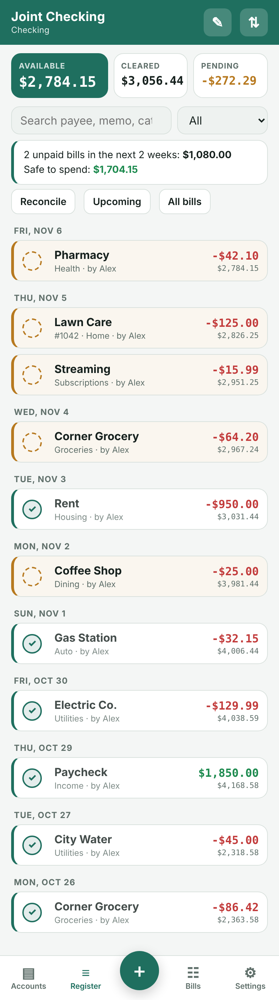
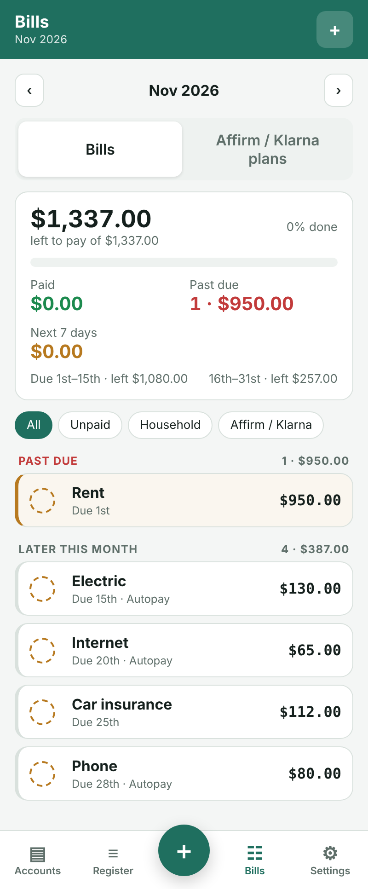
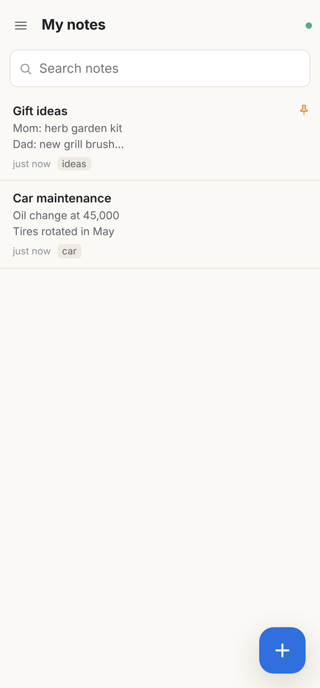
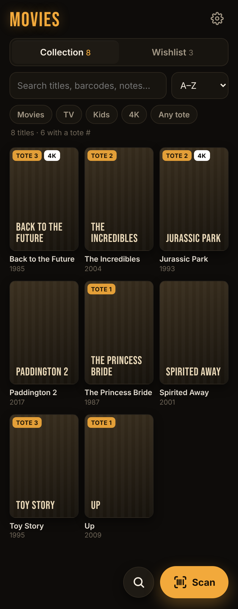
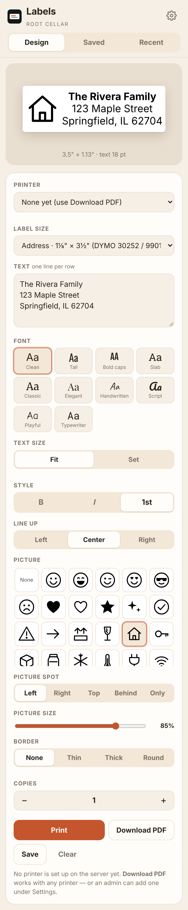
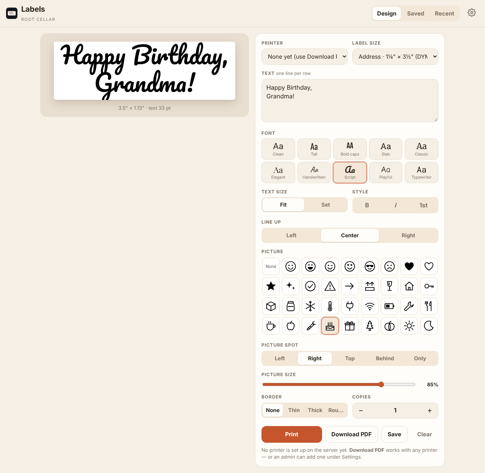

# Root Cellar — Setup Guide

**Your household apps, running on your own computer at home.** No subscriptions, no accounts with a company, and your data never leaves your house.

| App | What it does |
|---|---|
| **Checkbook** | A shared check register for the household. Running, cleared and available balances, reconcile against a statement, next check number, payee memory, and optional **Bills** (monthly checklist, Affirm/Klarna plans, autopay, "safe to spend", paydays that only count from 5 AM on payday). Imports CSV/QIF from other checkbook apps. Works offline on phones and PCs. |
| **Notes** | Private notes for each person plus a shared notebook. Pasted text keeps its exact spacing. Search, pins, tags, trash and version history. Imports from Simplenote. Works offline. |
| **Movies** | Your Blu-ray/DVD collection and wishlist. Scan a barcode with your phone camera to add a disc; if it's on the wishlist it offers to remove it. Optional storage spots (tote/box/shelf numbers), optional "Ripped" badges from Jellyfin, posters from TMDB. Imports a CSV (including from iCollect). |
| **Labels** | Design and print labels from any phone or computer: DYMO label sizes, 10 fonts, text size, bold/italic, alignment, borders and 45+ built-in pictures (or your own). Prints to a label printer plugged into your server, or download a PDF to print anywhere. Saved and recent labels. |

Every app has a **web version** (any browser, and on iPhone you can add it to the Home Screen), an **Android app**, and a **Windows app**.

### See them

<div class="shots">
<a href="screenshots/checkbook-1-accounts.png"><span>Checkbook</span></a>
<a href="screenshots/checkbook-3-bills.png"><span>Checkbook: Bills</span></a>
<a href="screenshots/notes-1-list.png"><span>Notes</span></a>
<a href="screenshots/movies-2-with-storage-spots.png"><span>Movies</span></a>
<a href="screenshots/labels-1-designer-phone.png"><span>Labels</span></a>
<a href="screenshots/labels-4-designer-desktop.png"><span>Labels on a computer</span></a>
</div>

> **Time needed:** about 30–45 minutes the first time, most of it waiting for downloads.
> **Skill needed:** if you can copy and paste, you can do this. Every command below has a **Copy** button.

---

## Contents

1. [What you need](#1-what-you-need)
2. [Get your server ready](#2-get-your-server-ready)
3. [Install Root Cellar (the easy way)](#3-install-root-cellar-the-easy-way)
4. [Or: install with Portainer](#4-or-install-with-portainer-nas-users)
5. [Reach your apps from anywhere (Tailscale)](#5-reach-your-apps-from-anywhere-tailscale)
6. [First-time setup in each app](#6-first-time-setup-in-each-app)
7. [Phones and computers](#7-phones-and-computers)
8. [App tips: Checkbook, Notes, Movies, Labels](#8-app-tips)
9. [Backups](#9-backups)
10. [Updating, stopping and removing](#10-updating-stopping-and-removing)
11. [Troubleshooting](#11-troubleshooting)
12. [Other apps like these](#12-other-apps-like-these)
13. [Building the phone and PC apps yourself](#13-building-the-phone-and-pc-apps-yourself)

---

## 1. What you need

**A computer that stays on.** This is your "server." Any of these work:

- An old laptop or desktop, or a small "mini PC" (used ones are cheap and quiet).
- A **Raspberry Pi 4 or 5** (4 GB or more).
- A **NAS** that can run Docker (Synology, Asustor, QNAP, Unraid, TrueNAS and others). See [section 4](#4-or-install-with-portainer-nas-users).
- A virtual machine on Proxmox or similar.

It needs about **2 GB of free memory** and **5 GB of disk space**, plus room for your data (which is tiny: years of checkbook entries are a few megabytes).

**Your home network**, and for using the apps away from home, a free **Tailscale** account (section 5).

**Optional:** a **DYMO LabelWriter** (400/450 series) or another label printer that Linux supports, plugged into the server by USB, for printing labels straight from your phone.

### What's in the download

| Folder / file | What it is |
|---|---|
| `START HERE.html` | This guide |
| `install.sh` | The one-command installer for Linux servers |
| `docker-compose.yml` | The same setup for Portainer / NAS users |
| `server/` | The four apps (this is what runs on your server) |
| `apps-for-phones-and-pcs/` | The Android apps (`.apk`) and the Windows installer |
| `screenshots/` | Pictures of every app |
| `build-it-yourself/` | Everything needed to rebuild the phone and PC apps (optional) |

---

## 2. Get your server ready

> **Already have a Linux server with SSH?** Skip to [section 3](#3-install-root-cellar-the-easy-way).
> **Using a NAS with Portainer?** Skip to [section 4](#4-or-install-with-portainer-nas-users).

### 2a. Install Ubuntu Server (free)

1. On your everyday PC, download **Ubuntu Server 24.04 LTS** from [ubuntu.com/download/server](https://ubuntu.com/download/server).
2. Write it to a USB stick with the free **[Balena Etcher](https://etcher.balena.io/)** or **[Rufus](https://rufus.ie/)** (Windows).
3. Plug the USB stick into the computer that will be your server and start it from the USB stick (usually by pressing **F12**, **F11** or **Esc** right after turning it on).
4. Follow the installer. The defaults are fine. When asked:
   - **Your name / server name / username / password:** pick anything, and write the username and password down.
   - **Install OpenSSH server:** ✅ **Yes** (this lets you control it from your PC).
5. When it finishes, remove the USB stick and let it restart.
6. Log in on the server with your username and password, then find its address on your network:

```
hostname -I
```

The first number (like `192.168.1.50`) is your **server's address**. Write it down.

> **Tip:** In your router's settings, "reserve" this address for the server so it never changes. Look for *DHCP reservation* or *static lease*.

### 2b. Connect to your server from your PC

From now on you can type commands from your normal PC. On **Windows 10/11**, open **PowerShell** (Start menu → type *PowerShell*). On a **Mac**, open **Terminal**. Then type (use your username and server address):

```
ssh yourusername@192.168.1.50
```

Type `yes` if it asks about a fingerprint, then your password (nothing shows while you type, that's normal).

---

## 3. Install Root Cellar (the easy way)

### 3a. Copy the Root Cellar folder to your server

1. On your PC, **right-click the Root Cellar download (.zip) → Extract All**. You get a folder called `root-cellar`.
2. Open **PowerShell** (Windows) or **Terminal** (Mac) **on your PC** (not the SSH window), go to the folder that contains the `root-cellar` folder (for example your Downloads folder), and copy it over:

```
cd ~/Downloads
```

```
scp -r root-cellar yourusername@192.168.1.50:~
```

> **Prefer dragging and dropping?** The free **[WinSCP](https://winscp.net/)** app does the same thing: connect to your server's address with your username and password, then drag the `root-cellar` folder into your home folder on the right.

### 3b. Run the installer

In your **SSH window** (connected to the server):

```
cd ~/root-cellar && sudo bash install.sh
```

It will:

1. Install **Docker** if it isn't there yet (it asks first).
2. Ask which apps you want (press **Enter** to say yes to each, or type `n` to skip one).
3. Ask your **time zone** (Enter keeps what it found) and where to put things (Enter keeps `/opt/root-cellar`).
4. Start the apps and wait until they answer.
5. Print the address of each app.

When it's done you'll see something like this:

```
    App         At home                        Anywhere (Tailscale, HTTPS)
    Checkbook   http://192.168.1.50:5080
    Notes       http://192.168.1.50:8085
    Movies      http://192.168.1.50:8093
    Labels      http://192.168.1.50:8095
```

**Open one of those addresses in your browser** and you're in. Go to [section 6](#6-first-time-setup-in-each-app).

> The "Anywhere" column fills in after you set up Tailscale (section 5). Just run `sudo bash install.sh` again afterwards; it keeps all your data.

---

## 4. Or: install with Portainer (NAS users)

Use this if your NAS or server runs **Portainer** (a web page for managing Docker) and you'd rather not use the command line.

1. Copy the `server` folder from the download onto your NAS, into a new folder called `root-cellar`. For example, on many NAS units you'd end up with `/volume1/docker/root-cellar/server` (open your NAS's file manager to see what the path looks like, and note the full path).
2. In Portainer: **Stacks → + Add stack**. Name it `root-cellar`.
3. Choose **Web editor**, open `docker-compose.yml` from the download in Notepad, and paste the whole thing in.
   - Don't want one of the apps? Delete its block (from its name, like `  movies:`, down to the line before the next app).
4. Scroll down to **Environment variables → Add an environment variable** and add two:

| Name | Value |
|---|---|
| `RC_DIR` | the folder that **contains** `server`, e.g. `/volume1/docker/root-cellar` |
| `TZ` | your time zone, e.g. `America/New_York` ([list of time zones](https://en.wikipedia.org/wiki/List_of_tz_database_time_zones)) |

5. Click **Deploy the stack**. The first start takes a minute or two (Checkbook installs its parts and Labels installs the printer system).
6. Open `http://YOUR-NAS-ADDRESS:5080` (Checkbook), `:8085` (Notes), `:8093` (Movies), `:8095` (Labels).

> **Port already in use?** Change the **left** number in that app's `ports:` line (for example `"5081:8080"`) and use that number in the address instead.

---

## 5. Reach your apps from anywhere (Tailscale)

At home, the addresses above just work. To use the apps **away from home**, and to unlock the features that need a secure **https://** address (installing on iPhone, camera barcode scanning in Movies, offline mode in Checkbook and Notes), use **Tailscale**. It's free for personal use and creates a private network between your devices. Nothing is opened to the internet.

### 5a. Make a Tailscale account and set it up

1. Go to [tailscale.com](https://tailscale.com/) → **Get started**, and sign in (Google, Microsoft, Apple or GitHub account).
2. In the **Tailscale admin console** → **DNS** page:
   - Make sure **MagicDNS** is **on**.
   - Under **HTTPS Certificates**, click **Enable HTTPS**.

### 5b. Put Tailscale on the server

In your SSH window:

```
curl -fsSL https://tailscale.com/install.sh | sh
```

```
sudo tailscale up
```

It prints a link. Open it on your PC, sign in, and approve the server. Then run the Root Cellar installer again so it turns on the https addresses:

```
cd ~/root-cellar && sudo bash install.sh
```

Say **yes** when it asks to turn on HTTPS. The "Anywhere" column now shows addresses like:

```
https://myserver.tail1234.ts.net:8443   (Checkbook)
https://myserver.tail1234.ts.net:8444   (Notes)
https://myserver.tail1234.ts.net:8445   (Movies)
https://myserver.tail1234.ts.net:8446   (Labels)
```

**Use these https addresses on your phones and laptops**, at home and away.

> **Portainer/NAS users:** install the Tailscale app from your NAS's app store, then turn on the addresses from the NAS's terminal (or SSH) with one command per app:
> ```
> tailscale serve --bg --https=8443 http://127.0.0.1:5080
> ```
> ```
> tailscale serve --bg --https=8444 http://127.0.0.1:8085
> ```
> ```
> tailscale serve --bg --https=8445 http://127.0.0.1:8093
> ```
> ```
> tailscale serve --bg --https=8446 http://127.0.0.1:8095
> ```
> If port 443/8443 is already taken by something on your NAS, pick other numbers (e.g. 9443).

### 5c. Put Tailscale on every phone and computer

Install the **Tailscale** app on each phone and PC (App Store, Google Play, or [tailscale.com/download](https://tailscale.com/download)) and sign in with **the same account**. Leave it on.

> **Sharing with family?** In the admin console you can invite people to your network (**Users → Invite**), so they don't need your login.

---

## 6. First-time setup in each app

The **first person to open each app creates the admin account**. The admin can add everyone else in the household.

- **Checkbook:** create your account → **Accounts → +** to add your bank account with its starting balance. Add other people under **Settings → Users**. Turn on **Bills** under **Settings → Features** if you want it.
- **Notes:** create your account → add others under **Settings → People**. Each person gets **My notes**; everyone shares **Shared notes**.
- **Movies:** create your account → add people under **Settings → People**. Optional: turn on **Storage spots** or **Ripped badges** under **Settings → Features**.
- **Labels:** create your account → if a printer is plugged into the server, **Settings → Add a printer**. Otherwise just use **Download PDF**.

Use a different password for each app (a password manager makes this painless).

---

## 7. Phones and computers

### Android

1. On the phone, open the **`apps-for-phones-and-pcs`** folder (copy it to the phone, or email the `.apk` files to yourself, or put them in Google Drive).
2. Tap an app file, like `root-cellar-checkbook.apk`.
3. The first time, Android asks to allow installs from that app (Files, Chrome, Drive…). Tap **Settings → Allow from this source**, then go back and tap **Install**.
4. Open the app and type your server address (the **https** Tailscale one from section 5, or the home address).

| File | App |
|---|---|
| `root-cellar-checkbook.apk` | Checkbook (keeps a full offline copy) |
| `root-cellar-notes.apk` | Notes (keeps a full offline copy) |
| `root-cellar-movies.apk` | Movies (camera scanning) |
| `root-cellar-labels.apk` | Labels |

> Google Play Protect may say the app is from an unknown developer. That's expected for apps that aren't in the Play Store: tap **More details → Install anyway**.

### iPhone and iPad

Apple doesn't allow installing apps from outside the App Store without a paid developer account, so on iPhone you use the **web apps**, added to the Home Screen. They open full-screen like a normal app, and Checkbook and Notes keep an offline copy.

1. Open **Safari** and go to the app's **https** address (from section 5).
2. Tap the **Share** button (square with an arrow) → **Add to Home Screen** → **Add**.
3. Open it from the Home Screen icon from now on.

### Windows

1. Run **`Root Cellar Setup 1.0.0.exe`** from the `apps-for-phones-and-pcs` folder.
2. Windows may say **"Windows protected your PC."** Click **More info → Run anyway** (this shows for any app that isn't from a big company that paid Microsoft for a certificate).
3. You get a **Root Cellar** folder in the Start menu with **Checkbook, Notes, Movies and Labels**, each with its own icon and taskbar button. Tick **Desktop shortcuts** in the installer if you want them on the desktop too.
4. The first time you open Movies or Labels it asks for the server address. Checkbook and Notes ask when you sign in.

> Press **Ctrl + Shift + L** in any Root Cellar window to open the launcher, where you can also change the Movies and Labels server addresses.

### Mac, Linux, Chromebook

Use the web apps in Chrome, Edge or Safari. In Chrome/Edge, click the **install** icon at the right end of the address bar to get a desktop window and icon.

---

## 8. App tips

### Checkbook

- **Importing from another checkbook app:** export a **CSV** or **QIF** from the old app, then **Settings → Import from another app**. Check the column matches, pick the account, and import. Made a mistake? **Settings → Past imports → Undo**.
- **Cleared vs. pending:** tap the circle on an entry to mark it cleared. Reconcile against your bank statement from the account page.
- **Bills** (turn on under **Settings → Features**): a monthly checklist. Marking a bill paid posts it to the register, and entering a matching payment in the register offers to tick the bill.
- **Paydays:** under **Settings → Bills settings**, add each person's payday. Paychecks you enter ahead of time are **never counted as available until 5:00 AM on payday**.
- **Offline:** the Android and Windows apps (and the iPhone Home Screen version) keep a full copy. If the server is down you still see everything as of the last sync and can keep adding entries; they sync when it's back.

### Notes

- **Moving from Simplenote:** in Simplenote, export your notes (**Settings → Tools → Export notes** on the web, or **File → Export Notes** in the desktop app). Then in Notes, **Settings → Import from Simplenote** and pick the `.zip`.
- Copy and paste keeps your exact spacing and blank lines.
- Every save is kept in **History**, so you can go back to an older version of a note.

### Movies

- **Scanning:** tap **Scan** and point the camera at the barcode on the case. Scanning needs the **https** address (or the Android app).
- **Posters and title search:** get a free **TMDB API key** at [themoviedb.org](https://www.themoviedb.org/) (sign up → **Settings → API**) and paste it in **Settings**. If you run **Jellyfin**, you can connect it instead (or as well).
- **Barcode lookups** use the free UPCitemdb service (100 a day). Discs already in your collection are recognized without using a lookup.
- **Coming from iCollect or a spreadsheet:** export a CSV and use **Settings → Import a CSV**. It understands columns like Title, Year, Format, Barcode/UPC, Collection/Wishlist and Notes.
- **Storage spots** (Settings → Features): give each disc a tote, box or shelf number while things are packed away. Rename it to whatever you use.

### Labels

- **Adding a DYMO printer:** plug it into the **server** by USB and turn it on, then **Settings → Add a printer**. Pick it from the list, pick the model (for example *DYMO LabelWriter 450 Turbo*), and save.
  - **Twin Turbo (two rolls):** add it twice, once as **Left roll** and once as **Right roll**, each with its usual label size.
  - Plugged it in after Labels started? Restart Labels once: `cd /opt/root-cellar && sudo docker compose restart labels`
- **Not quite centered?** Use the **Nudge** settings on the printer (in millimeters).
- **No printer on the server?** **Download PDF** and print it from your computer with your printer's normal software, using "Actual size."
- DYMO's newest **LabelWriter 550/5XL** models don't support Linux printing. Use Download PDF with DYMO's own software for those.

---

## 9. Backups

Everything lives in one folder: **`/opt/root-cellar/data`** (or `RC_DIR/data` for Portainer installs). Each app also makes its own **nightly backup** inside its data folder (kept 14–30 days).

To copy everything somewhere safe (another disk, your NAS, a USB stick), from the server:

```
sudo tar czf ~/root-cellar-backup-$(date +%F).tar.gz -C /opt/root-cellar data
```

Then copy that file off the server (WinSCP, or `scp yourusername@192.168.1.50:~/root-cellar-backup-*.tar.gz .` from your PC).

**To restore:** stop the apps, put the `data` folder back, start them again:

```
cd /opt/root-cellar && sudo docker compose stop
```

```
cd /opt/root-cellar && sudo docker compose up -d
```

---

## 10. Updating, stopping and removing

- **Update to a new version:** copy the new `root-cellar` folder to the server (section 3a) and run `cd ~/root-cellar && sudo bash install.sh` again. Your data is kept.
- **Update the underlying Node.js images** (security fixes), every few months:

```
cd /opt/root-cellar && sudo docker compose pull && sudo docker compose up -d
```

- **Stop everything:** `cd /opt/root-cellar && sudo docker compose stop`
- **Start again:** `cd /opt/root-cellar && sudo docker compose up -d`
- **See what an app is doing (logs):** `sudo docker logs --tail 50 root-cellar-checkbook` (or `-notes`, `-movies`, `-labels`)
- **Remove Root Cellar completely** (⚠ deletes your data unless you back it up first):

```
cd /opt/root-cellar && sudo docker compose down && sudo rm -rf /opt/root-cellar
```

---

## 11. Troubleshooting

**The page won't load.**
- Is the server on? Can you reach it at all: `ping 192.168.1.50` from your PC?
- Are the apps running? `sudo docker ps` should list `root-cellar-…` containers. If one is missing, `sudo docker logs root-cellar-checkbook` shows why.
- Away from home? Make sure **Tailscale is on** on your phone/PC and use the **https** address.

**"Install" / "Add to Home Screen" doesn't make a full-screen app, or the Movies camera won't open.**
- Those need the **https** address (section 5). Plain `http://192.168…` addresses work for everything else.

**Checkbook takes a while to start the very first time.**
- Normal: it downloads its parts (about a minute). Watch with `sudo docker logs -f root-cellar-checkbook`.

**Labels says "the print system isn't running."**
- The first start installs it from the internet; give it a couple of minutes, then check `sudo docker logs root-cellar-labels`. **Download PDF** always works in the meantime.

**I forgot my password.**
- **Checkbook:** an admin opens **Settings → Users → Edit** next to your name and sets a new one.
- **Movies, Labels:** an admin opens **Settings → People → Reset password**.
- **Notes:** on the server, run (with your username and a new password of 8+ characters):

```
sudo docker exec root-cellar-notes node server.js reset-password yourusername newpassword123
```

**The Android app says it can't reach the server.**
- Check the address (including `https://` and the `:port`). Tailscale must be on. Movies and Labels have **Settings → Change server address**.

**Windows says the installer is unsafe.**
- See section 7: **More info → Run anyway**.

---

## 12. Other apps like these

Root Cellar is meant to be simple, matching, and easy to set up. If you want more features, these excellent free self-hosted projects are worth a look:

- **Money:** [Actual Budget](https://actualbudget.org/) (envelope budgeting), [Firefly III](https://www.firefly-iii.org/) (full personal finance).
- **Groceries & pantry:** [Grocy](https://grocy.info/), [KitchenOwl](https://kitchenowl.org/).
- **Notes:** [Joplin](https://joplinapp.org/) (with Joplin Server), [Memos](https://usememos.com/).
- **Disc collections:** [DVinyl](https://github.com/Kyonew/Dvinyl) (vinyl, CDs, books, movies, games).
- **Everything-in-one family planners:** Yuvomi, Home-Ops, HomeHub.

---

## 13. Building the phone and PC apps yourself

You don't need to. The ready-made apps are in `apps-for-phones-and-pcs`. But if you change the apps, or want your own signing key, everything is in `build-it-yourself/` with a `README` that explains the two scripts (`build-android.sh`, `build-windows.sh`). They run on Linux and need no Android Studio or Windows PC.

---

*Root Cellar is free and open source (MIT license). Fonts are under the SIL Open Font License; see `THIRD-PARTY-NOTICES.txt`.*

*How this was made: the ideas, design decisions and real-world testing are by Root Cellar's creator; the code was written with help from **Claude**, an AI assistant made by Anthropic.*

*Fixes, updates and ideas are welcome: open an Issue or send a pull request at [github.com/Noobie3DPrinting/root-cellar](https://github.com/Noobie3DPrinting/root-cellar).*
