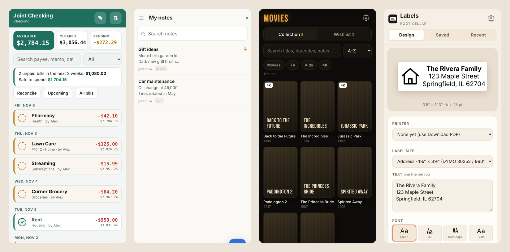
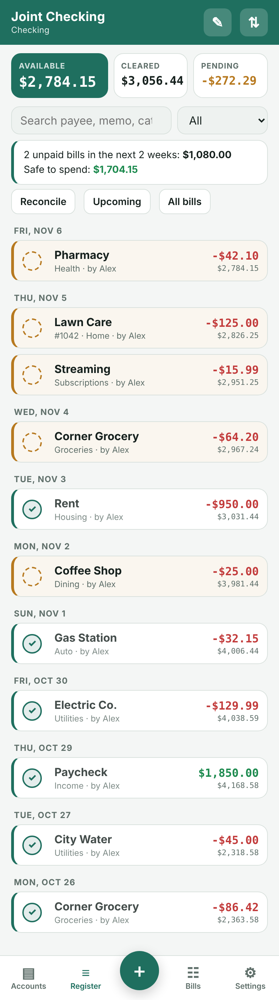
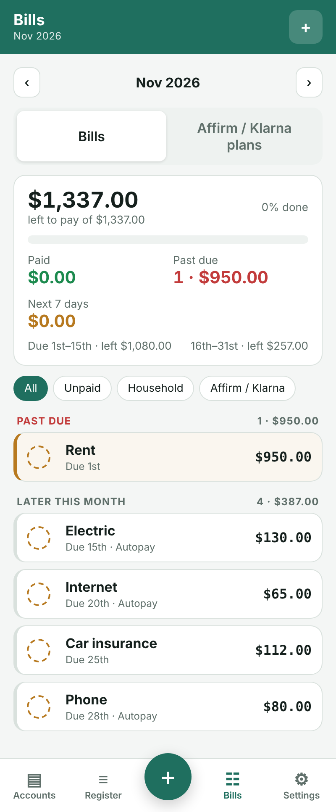
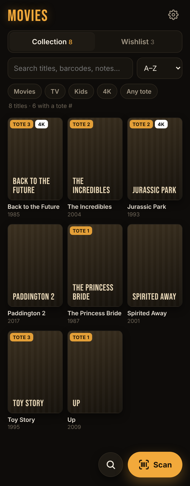
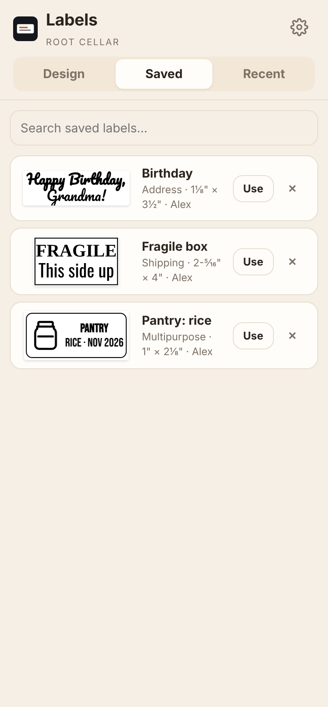
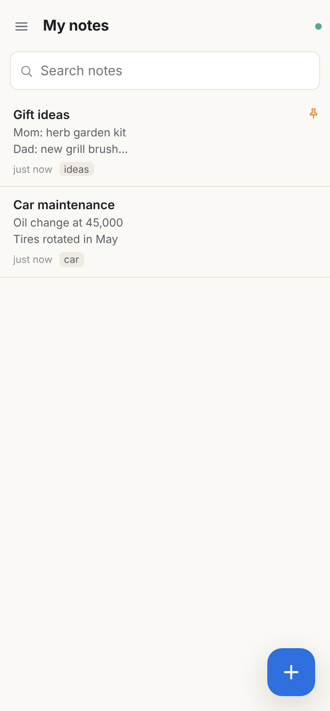
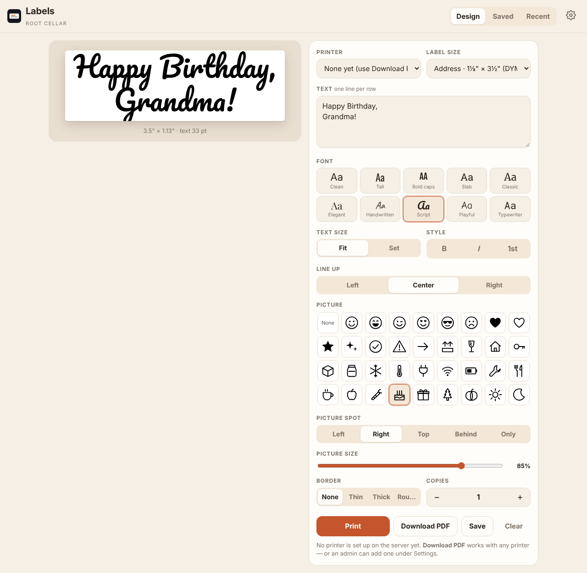

# Root Cellar

**Your household apps, running on your own computer at home.** A shared checkbook, notes, a movie collection and a label maker. No subscriptions, no accounts with a company, and your data never leaves your house.



| App | What it does |
|---|---|
| **Checkbook** | A shared check register: running, cleared and available balances, reconcile against a statement, payee memory, and optional **Bills** (monthly checklist, payment plans, autopay, "safe to spend", paydays). Imports CSV/QIF. Works offline on phones and PCs. |
| **Notes** | Private notes for each person plus a shared notebook. Search, pins, tags, trash and version history. Imports from Simplenote. Works offline. |
| **Movies** | Your Blu-ray/DVD collection and wishlist. Scan a barcode with your phone camera to add a disc. Optional storage spots (tote/box/shelf), "Ripped" badges from Jellyfin, posters from TMDB. Imports CSV. |
| **Labels** | Design labels in any browser and print to a DYMO LabelWriter plugged into your server (Twin Turbo supported), or download a PDF. 7 label sizes, 10 fonts, 47 built-in pictures or your own. |

Every app works in any browser, on **Android** (app), **Windows** (app) and **iPhone** (Safari → Add to Home Screen).

## Install

**[Download the latest release](../../releases/latest)** → unzip `root-cellar-1.0.0.zip` → open **START HERE.html**. The guide is written for beginners, with a Copy button on every command.

Short version, on any Linux machine (Ubuntu, Debian, Raspberry Pi OS, a Proxmox VM):

```
sudo bash install.sh
```

It installs Docker if needed (it asks first), lets you pick which apps you want, and prints each app's address. NAS and Portainer users can paste [`docker-compose.yml`](docker-compose.yml) as a stack instead. For HTTPS on your phones away from home, the installer can set up [Tailscale](https://tailscale.com/) addresses for you.

| App | Port | Tailscale HTTPS port |
|---|---|---|
| Checkbook | 5080 | 8443 |
| Notes | 8085 | 8444 |
| Movies | 8093 | 8445 |
| Labels | 8095 | 8446 |

The full guide is in [GUIDE.md](GUIDE.md): server setup, Portainer, Tailscale, phones, backups, updates and troubleshooting.

## More pictures

| | | |
|---|---|---|
|  |  |  |
| Checkbook | Bills | Movies |
|  |  |  |
| Saved labels | Notes | Labels on a computer |

## Your data

Everything lives in one folder on your server, `/opt/root-cellar/data`. Back it up by copying it anywhere. Updating is copying the new release to the server and running `sudo bash install.sh` again; your data is kept.

## Building the apps yourself

The Windows installer and Android apps build on Linux, without Android Studio or a Windows PC. See [build-it-yourself/README.md](build-it-yourself/README.md).

## Contributing

**Fixes, improvements and ideas are all welcome!** Root Cellar gets better every time someone uses it in a different house.

- **Found a bug or have an idea?** [Open an Issue](../../issues) and describe what happened or what you'd like.
- **Have a fix?** Send a pull request. Small fixes (bugs, typos, clearer guide steps) can go straight in; for bigger changes or new features, open an Issue first so we can talk it over.
- **Not a coder?** Telling me which step of the guide confused you is just as helpful.

## How this was made

The ideas, design decisions and real-world testing are mine; the code was written with help from **Claude**, an AI assistant made by Anthropic. Every app runs in my house every day, and each release is tested on a fresh virtual machine before it's shared.

## License

[MIT](LICENSE.txt). Bundled fonts and libraries keep their own licenses; see [THIRD-PARTY-NOTICES.txt](THIRD-PARTY-NOTICES.txt). Support is best effort, and fixes and updates from anyone are welcome.
